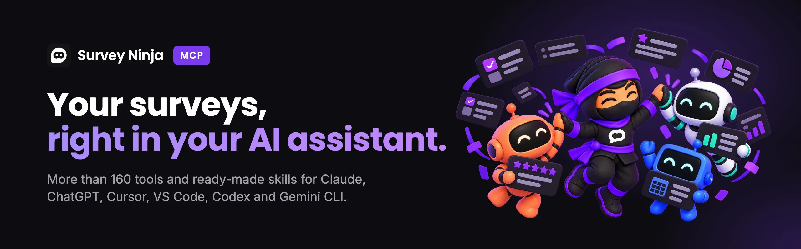

<p align="center">
  
</p>

<p align="center">
  <a href="#quick-start"><b>Quick start</b></a>&nbsp;&nbsp;|&nbsp;&nbsp;<a href="#skills"><b>Skills</b></a>&nbsp;&nbsp;|&nbsp;&nbsp;<a href="docs/tools.md"><b>Tools</b></a>&nbsp;&nbsp;|&nbsp;&nbsp;<a href="docs/prompts.md"><b>What to ask</b></a>&nbsp;&nbsp;|&nbsp;&nbsp;<a href="docs/connect.md"><b>Connecting</b></a>
</p>

<p align="center">
<!-- generated:badges -->
  <a href="skills/"></a>
  <a href="docs/tools.md"></a>
<!-- /generated:badges -->
  
  
  <a href="LICENSE"></a>
</p>

The [SurveyNinja](https://surveyninja.io/?utm_source=github&utm_medium=readme&utm_campaign=mcp) MCP server and
ready-made skills for your AI assistant. Describe a survey in plain words and the assistant builds it in your
account, checks it before launch, reads the responses and prepares a report you can send.

Works in Claude, ChatGPT, Claude Code, Cursor, VS Code, Codex, Gemini CLI and other assistants that connect to
remote MCP servers. Every SurveyNinja plan includes it, Free too.

```text
You:  Build a survey for our repair shop customers: rate the work and collect
      contacts for a follow-up visit.
AI:   ✓ picked question types  ✓ built 7 questions and 2 branches  ✓ applied a theme
      The draft is ready and does not open by its link yet. Publish it?
```

## Quick start

1. **Have a SurveyNinja account.** [Sign up for free](https://app.surveyninja.io/#signup) if you don't have one.
2. **Add the server** `https://mcp.surveyninja.io/mcp/v1` to your assistant. Steps for each assistant are below.
3. **Allow access.** Sign in to SurveyNinja when the assistant asks, choose a workspace and click **Allow access**.
   Most assistants need no key; for the rest, use an API key as shown below.
4. **Ask:** “Show my surveys and how many responses came in this week.”

### Claude Code: everything in one install

The plugin adds the MCP server and every skill at once:

```text
/plugin marketplace add surveyninjaio/surveyninja-mcp
/plugin install surveyninja@surveyninja
```

Then type `/mcp`, select the SurveyNinja server and sign in. Only the server, without the skills:

```bash
claude mcp add --transport http surveyninja https://mcp.surveyninja.io/mcp/v1
```

### Claude and ChatGPT

**Claude** on the web or in the desktop app: **Settings → Connectors → Add custom connector**. Enter a name, for
example SurveyNinja, and the server address, click **Add**, then **Connect**, and allow access in SurveyNinja. On
Claude Team and Enterprise an organization owner adds the connector first, then each member connects it.

**ChatGPT:** turn on developer mode in the ChatGPT settings (it is available on some ChatGPT plans), create a
connector with the server address and OAuth authentication, then allow access in SurveyNinja.

### Other assistants

One click:

[](https://vscode.dev/redirect/mcp/install?name=surveyninja&config=%7B%22type%22%3A%22http%22%2C%22url%22%3A%22https%3A%2F%2Fmcp.surveyninja.io%2Fmcp%2Fv1%22%7D)
[](https://cursor.com/en/install-mcp?name=surveyninja&config=eyJ1cmwiOiJodHRwczovL21jcC5zdXJ2ZXluaW5qYS5pby9tY3AvdjEifQ%3D%3D)

<details>
<summary><b>Cursor</b></summary>

<br>

Add the server to `~/.cursor/mcp.json` for all projects, or to `.cursor/mcp.json` for one project, then open the
MCP section in the Cursor settings and sign in to the `surveyninja` server:

```json
{
  "mcpServers": {
    "surveyninja": {
      "url": "https://mcp.surveyninja.io/mcp/v1"
    }
  }
}
```

</details>

<details>
<summary><b>VS Code</b></summary>

<br>

Add the server to `.vscode/mcp.json` in your project, start it from the file and sign in when VS Code asks. The
server works in GitHub Copilot Chat in agent mode.

```json
{
  "servers": {
    "surveyninja": {
      "type": "http",
      "url": "https://mcp.surveyninja.io/mcp/v1"
    }
  }
}
```

</details>

<details>
<summary><b>Gemini CLI</b></summary>

<br>

As an extension, with the server and the skills at once:

```bash
gemini extensions install https://github.com/surveyninjaio/surveyninja-mcp
```

Or only the server, in `~/.gemini/settings.json`:

```json
{
  "mcpServers": {
    "surveyninja": {
      "httpUrl": "https://mcp.surveyninja.io/mcp/v1"
    }
  }
}
```

If Gemini CLI does not offer to sign in by itself, run `/mcp auth surveyninja`.

</details>

<details>
<summary><b>Codex</b></summary>

<br>

With an API key. Create one in SurveyNinja under **Settings → [API / MCP](https://app.surveyninja.io/account/api)**,
then add the server to `~/.codex/config.toml`:

```toml
[mcp_servers.surveyninja]
url = "https://mcp.surveyninja.io/mcp/v1"
bearer_token_env_var = "SURVEYNINJA_API_KEY"
```

Codex reads the key from the environment: `export SURVEYNINJA_API_KEY=YOUR_API_KEY`.

</details>

<details>
<summary><b>Any other client</b></summary>

<br>

Any client that connects to remote MCP servers over Streamable HTTP can use the same address. If it supports MCP
sign-in (OAuth), it opens SurveyNinja for you to allow access. If it does not, pass an API key in a header:

```text
Authorization: Bearer YOUR_API_KEY
```

</details>

The same configs as files are in [`clients/`](clients/), and every step with troubleshooting is in
[`docs/connect.md`](docs/connect.md).

## At a glance

<!-- generated:glance -->
| | |
|---|---|
| **Server** | `https://mcp.surveyninja.io/mcp/v1`, Streamable HTTP, nothing to deploy on your side |
| **Sign-in** | **Allow access** (OAuth): one workspace you choose, the assistant renews access by itself. Or an **API key** from **Settings → API / MCP**: every workspace where you are the owner or a member |
| **Tools** | 160+: 57 only read, 25 delete or overwrite data and are marked. [Full list](docs/tools.md) |
| **Permissions** | Yours: the assistant can do what your role and your plan allow, nothing more |
| **Plans** | Every plan, Free included |
| **Limits** | 180 requests per minute per user; links to exported files work for one hour |
<!-- /generated:glance -->

## What it can do

**Surveys.** Create a survey from scratch, from a template or with AI. Edit questions, logic, design and settings,
then publish.

**Responses.** Read responses, tag them and keep the account clean.

**Reports.** Summary, report, report with filters and AI report. Exports to CSV, Excel, Word, SPSS and PDF, public
links to share results.

**Delivery.** Notifications, webhooks, integrations and invitations to the team.

The full list by section is in [`docs/tools.md`](docs/tools.md), starter phrases in [`docs/prompts.md`](docs/prompts.md).

## Skills

A skill is a ready-made playbook for the assistant. You ask “sort out the open-ended answers”, and the skill tells
it which tools to call, in what order and how to present the result. Skills are text instructions with no code:
nothing gets installed or run. Each one is also on [surveyninja.io/skills](https://surveyninja.io/skills?utm_source=github&utm_medium=readme&utm_campaign=mcp)
with examples of the result.

<!-- generated:skills -->
### Build and share

| Skill | What you get | Download |
|---|---|:-:|
| [Build a survey from a brief](skills/surveyninja-survey-from-brief/) | Describe what you need in plain words, and the assistant builds the survey in your SurveyNinja account as a draft | [ZIP](https://surveyninja.io/skills/survey-from-brief.zip) |
| [Skip logic and branching](skills/surveyninja-survey-logic/) | Sets up survey logic so that no respondent ever hits a dead end | [ZIP](https://surveyninja.io/skills/survey-logic.zip) |
| [Rewrite survey copy](skills/surveyninja-survey-copy/) | Rewrites your questions so people finish the survey, starting from the data rather than taste | [ZIP](https://surveyninja.io/skills/survey-copy.zip) |
| [Distribute the survey](skills/surveyninja-survey-distribution/) | Gets the survey ready to hand out so you can still tell which channel each response came from | [ZIP](https://surveyninja.io/skills/survey-distribution.zip) |
| [Launch kit](skills/surveyninja-launch-kit/) | Puts the whole launch together at once: labeled links, announcement copy for each channel and a QR code | [ZIP](https://surveyninja.io/skills/launch-kit.zip) |

### Check before launch

| Skill | What you get | Download |
|---|---|:-:|
| [Pre-launch check](skills/surveyninja-prelaunch-check/) | Finds what will break on real respondents while the link is still unsent | [ZIP](https://surveyninja.io/skills/prelaunch-check.zip) |
| [Data quality check](skills/surveyninja-data-quality/) | Tells you whether the responses can be trusted before anyone builds conclusions on them | [ZIP](https://surveyninja.io/skills/data-quality.zip) |

### Understand results

| Skill | What you get | Download |
|---|---|:-:|
| [Survey results summary](skills/surveyninja-results-digest/) | Answers "so what did the survey say" with figures and a conclusion instead of a raw export | [ZIP](https://surveyninja.io/skills/results-digest.zip) |
| [Analyze open-ended answers](skills/surveyninja-open-answers/) | Turns a hundred lines of free text into a handful of themes with numbers and quotes | [ZIP](https://surveyninja.io/skills/open-answers.zip) |
| [Completion funnel](skills/surveyninja-response-funnel/) | Shows which question makes people close the tab, and why | [ZIP](https://surveyninja.io/skills/response-funnel.zip) |
| [A/B variant analysis](skills/surveyninja-ab-significance/) | Tells you whether the difference between variants is real or just noise | [ZIP](https://surveyninja.io/skills/ab-significance.zip) |
| [Comparing with past results](skills/surveyninja-benchmark/) | Compares a survey with its own past, because one figure means little and a change says a lot | [ZIP](https://surveyninja.io/skills/benchmark.zip) |
| [How many responses you need](skills/surveyninja-sample-size/) | Tells you whether what you have is enough and how many more responses you need before conclusions hold | [ZIP](https://surveyninja.io/skills/sample-size.zip) |
| [Survey timeline](skills/surveyninja-survey-timeline/) | Answers “why did responses stop” by lining up collection against the edit history | [ZIP](https://surveyninja.io/skills/survey-timeline.zip) |
| [Comparing traffic sources](skills/surveyninja-source-dashboard/) | Shows which channel brought the right people and which only brought numbers | [ZIP](https://surveyninja.io/skills/source-dashboard.zip) |
| [Results for the client](skills/surveyninja-results-sharing/) | Turns survey results into something you can send: a link, a file or a report with conclusions | [ZIP](https://surveyninja.io/skills/results-sharing.zip) |
| [Report and survey styling](skills/surveyninja-report-appearance/) | Tidies up what people see from outside: the survey theme, the report colors and the logo | [ZIP](https://surveyninja.io/skills/report-appearance.zip) |

### Deliver responses

| Skill | What you get | Download |
|---|---|:-:|
| [New response notifications](skills/surveyninja-answer-notifications/) | Sets up where new responses are announced, by email or in Telegram, and fixes it when they stop arriving | [ZIP](https://surveyninja.io/skills/answer-notifications.zip) |
| [Webhook setup](skills/surveyninja-webhook-setup/) | Sends survey responses to your own address and checks that the receiver accepted them | [ZIP](https://surveyninja.io/skills/webhook-setup.zip) |
| [Why responses are not delivered](skills/surveyninja-integration-triage/) | Finds why responses never reach your Telegram, Google Sheet, Zapier or webhook, and what to do about it | [ZIP](https://surveyninja.io/skills/integration-triage.zip) |
| [Lead quality](skills/surveyninja-lead-quality/) | Counts the people who left a contact you can actually use | [ZIP](https://surveyninja.io/skills/lead-quality.zip) |

### Keep the account tidy

| Skill | What you get | Download |
|---|---|:-:|
| [Workspace audit](skills/surveyninja-account-audit/) | Shows in one report where your workspace is losing responses, storage and attention | [ZIP](https://surveyninja.io/skills/account-audit.zip) |
| [Tidying up the account](skills/surveyninja-workspace-housekeeping/) | Sorts, archives, copies and cleans, and knows which of those cannot be undone | [ZIP](https://surveyninja.io/skills/workspace-housekeeping.zip) |
| [Members and access](skills/surveyninja-workspace-access/) | Finds out why a colleague cannot see the surveys and grants exactly the rights they need | [ZIP](https://surveyninja.io/skills/workspace-access.zip) |
| [Cleaning up responses](skills/surveyninja-answers-cleanup/) | Removes test runs and duplicates from your results and shows you the list before anything goes | [ZIP](https://surveyninja.io/skills/answers-cleanup.zip) |
<!-- /generated:skills -->
All skills in one archive: [all.zip](https://surveyninja.io/skills/all.zip).

### Installing skills without the plugin

One command for any assistant: [skills](https://skills.sh) finds the agents you have installed and asks where to
put the skills.

```bash
npx skills add surveyninjaio/surveyninja-mcp
```

Or unzip an archive into the folder your assistant reads skills from and restart it: `.claude/skills/` for Claude
Code, `.agents/skills/` for Codex and Cursor, `.gemini/skills/` for Gemini CLI. More in
[`skills/README.md`](skills/README.md).

## Security

- With **Allow access** the assistant works in the one workspace you chose and loses access when you leave it or
  remove the connector. An **API key** stops working the moment you delete it in **Settings → API / MCP**.
- Tools that cannot be undone, such as deleting surveys or responses, carry the `destructiveHint` annotation, so
  your client can ask before it calls them. Read what the assistant is about to do before you confirm.
- Every skill has a “What not to do” section: things the assistant must not do without your word.
- There are no secrets in this repository. Configs use `YOUR_API_KEY` as a placeholder. Found something that looks
  like a real key, or a security issue? See [SECURITY.md](SECURITY.md).

## Privacy

The plugin and the skills run nothing on your computer: the skills are text instructions, and the plugin only adds
the server address to your client. The one connection is to `https://mcp.surveyninja.io/mcp/v1` over HTTPS, and it
carries what your assistant asks for: your surveys, responses and reports in your SurveyNinja account. SurveyNinja
stores that data on a server in the EU behind Cloudflare and handles it under the
[privacy policy](https://surveyninja.io/privacy).

## Links

- [SurveyNinja](https://surveyninja.io/?utm_source=github&utm_medium=readme&utm_campaign=mcp)
- [MCP server page](https://surveyninja.io/features/mcp-server?utm_source=github&utm_medium=readme&utm_campaign=mcp)
- [Skills catalog](https://surveyninja.io/skills?utm_source=github&utm_medium=readme&utm_campaign=mcp)
- [MCP and API documentation](https://surveyninja.io/dev/api/mcp?utm_source=github&utm_medium=readme&utm_campaign=mcp)
- [LinkedIn](https://www.linkedin.com/company/surveyninjaio)

## License

MIT, see [LICENSE](LICENSE). The license covers what is in this repository: documentation, configs and skills.
The SurveyNinja service itself is provided under its [user agreement](https://surveyninja.io/agreement).
